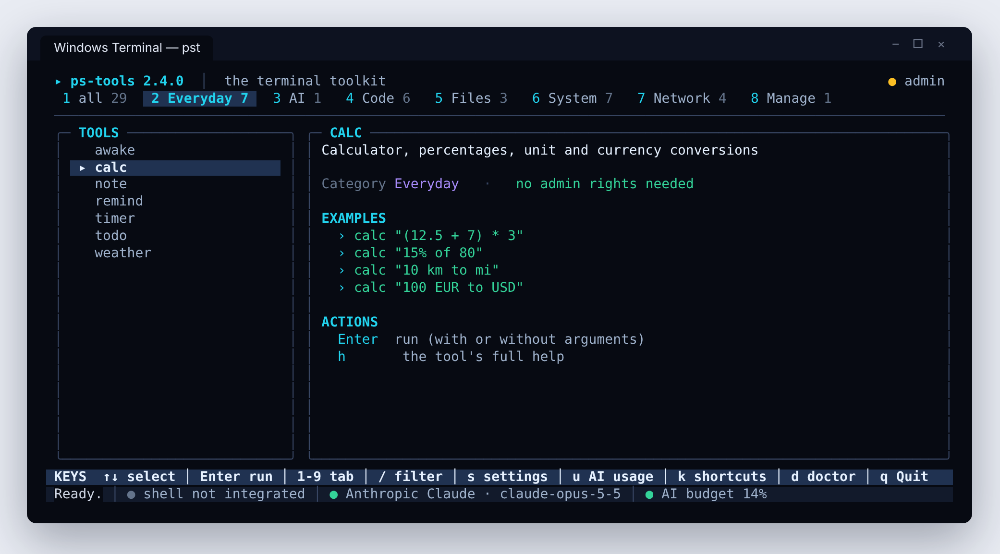

<div align="center">

```
 ██▄         █████▄ ▄█████       ██████ ▄████▄ ▄████▄ ██     ▄█████
  ▀██▄       ██  ██ ██             ██   ██  ██ ██  ██ ██     ██
    ▀██▄     █████▀ ▀████▄ ▄▄▄▄    ██   ██  ██ ██  ██ ██     ▀████▄
  ▄██▀       ██         ██         ██   ██  ██ ██  ██ ██         ██
 ██▀  ▄▄▄▄▄  ██     █████▀         ██   ▀████▀ ▀████▀ ██████ █████▀
```

**The Windows terminal toolkit** · [Version française](README.md)

About thirty commands for everyday life and for code: tasks, notes, timer, weather, calculator,
Downloads tidy-up, AI assistant, Git, system, network. A full-screen dashboard and shell integration,
**in English or French**, with or without administrator rights.

[](https://github.com/mpgamer75/ps-installation/actions/workflows/ci.yml)


[](LICENSE)



</div>

## Install

In any PowerShell terminal, **no elevation needed**:

```powershell
irm https://raw.githubusercontent.com/mpgamer75/ps-installation/main/install.ps1 | iex
```

A wizard walks you through it, and nothing changes before the final summary:

| Step | What you choose |
| --- | --- |
| **Language** | English or Français; every following screen switches immediately. |
| **Welcome** | Environment check (Windows, PowerShell, rights, local or network profile). |
| **Scope** | Just you, or all users (offered only when running as administrator). |
| **Tools** | Which commands to install (all ticked by default). |
| **Appearance** | Colour theme: Cyan (default, dark DefenseClaw-style panels), Night, Ocean, Amber, Light, Mono. |
| **Shell** | Richer prompt, key bindings, Unix-style commands, with a guided fix if your profile is blocked. |
| **AI** | Provider, API key (checked live), model with its price, monthly budget. |
| **Summary** | Review, jump back to any step, then install. |

`Esc` goes back one step. Everything can be changed later with `pst setup`.

Without a user: `& ([scriptblock]::Create((irm https://raw.githubusercontent.com/mpgamer75/ps-installation/main/install.ps1))) -Yes`
(also `-Scope AllUsers`, `-Tools todo,math`, `-NoPath`, `-Shell` / `-NoShell`).

## The tools

Just type `pst`: the **dashboard** sorts tools into tabs (1 Everyday, 2 AI, 3 Code…), shows each
tool's card and examples, and runs it with `Enter`. `/` filters, `s` opens settings, `q` quits.

| Command | What it does | Admin |
| --- | --- | --- |
| **Everyday** | | |
| `todo` | To-do list: due dates in plain words ("tomorrow", "monday"), priorities, tags | no |
| `note` | Quick notes and journal, one Markdown file per day, search | no |
| `timer` | Big-digit countdown, stopwatch, Pomodoro, alert | no |
| `remind` | Reminders with Windows notifications, even with the terminal closed | no |
| `weather` | Current weather and 3-day forecast | no |
| `math` | Calculator, percentages, units, currencies (works offline) | no |
| `awake` | Keeps the PC awake (presentation, long download) | no |
| **AI** | | |
| `ask` | AI assistant (Claude, GPT, Gemini, Mistral, Ollama…): tokens and cost shown | no |
| **Code** | | |
| `gst` | Git dashboard: branch, sync, changes | no |
| `loc` | Lines of code per language, TODO/FIXME notes | no |
| `gitignore` | Generates and merges `.gitignore` from your project | no |
| `cheat` | Ready-to-copy command examples (tldr), offline | no |
| `serve` | Instant local web server for a folder | optional |
| `dev` | uuid, passwords, hash, base64, URL, JSON, JWT, dates | no |
| **Files** | | |
| `tidy` | Sorts a messy folder (Downloads) by type or month, with undo | no |
| `dupes` | Finds duplicates and frees space (Recycle Bin) | no |
| `dsize` | Ranks a folder's content by size | optional |
| **System** | | |
| `monitor` | Live dashboard: CPU, memory, disks, network, processes | no |
| `sysinfo` | Your PC's identity card | no |
| `clean` | Cleaner with preview before deleting | optional |
| `paths` | Inspects and fixes PATH: duplicates, missing folders | optional |
| `watch` | Re-runs a command and highlights changes | no |
| `logtail` | Follows a log live, colours by level, filter | no |
| `events` | Recent Windows errors and warnings, grouped | optional |
| **Network** | | |
| `speed` | Speed test with a plain verdict ("fine for HD video calls") | no |
| `ping-mon` | Multi-host latency: jitter, loss, history | no |
| `netinfo` | Interfaces, addresses, DNS, Wi-Fi, public IP | no |
| `ports` | Listening ports and their processes | optional |
| **Manage** | | |
| `pst` | Dashboard, settings, shortcuts, shell integration, updates | no |
| `pst-uninstall` | Uninstalls ps-tools | no |

Every command answers `-Help`. "Optional" means the tool works fully as a standard user and does a
bit more as administrator.

```powershell
todo add "Buy bread" -Due tomorrow
note "Idea: compare insurance quotes"
timer 25m -Label "Tea"
math "15% of 80"; math "10 km to mi"; math "100 EUR to USD"
weather -Set London
tidy -DryRun; tidy; tidy -Undo
ask -Cmd "the 10 biggest files in this folder"
Get-Content error.log -Tail 80 | ask "what happened?"
```

Network access: `weather` uses wttr.in, `math` (currencies only) frankfurter.dev, `speed`
speed.cloudflare.com, `gitignore` toptal.com, `cheat` tldr pages on GitHub, `netinfo` api.ipify.org.
None needs a key. `ask` sends your question to the AI provider you chose, with your own key.

## AI assistant

`ask -Setup` (or `pst setup`) picks the provider: Anthropic Claude, OpenAI, Google Gemini, Mistral,
Groq, DeepSeek, xAI, OpenRouter, Ollama (local, free) or any OpenAI-compatible service. The key is
checked against the service and stored **encrypted for your Windows account** (DPAPI). Each answer
ends with `model · tokens in ► out · cost · time`; `ask -Usage` shows today / week / month, cost per
day and per model, and your monthly budget gauge.

## Shell integration

`pst shell on` adds one line to your PowerShell profile (no admin rights, `pst shell off` removes it):
a clear prompt (folder, Git branch, duration, errors), smarter history, key bindings (`Alt+A` turns the
sentence you typed into a command with the AI, `Alt+S` sudo, `Alt+C` copy, `Alt+G` Git), Unix-style
commands (`ll`, `grep`, `touch`, `which`, `sudo`…), folder bookmarks (`mark` / `jump`) and `fix`
(explains the last error). It never replaces a custom prompt or an existing command.

**Profile on a network share** (redirected Documents, "is not digitally signed" at startup): ps-tools
tests that the profile can really load before writing to it, and offers three reversible fixes —
trust the file server (Local intranet zone, your account only), allow unsigned scripts for your
account, or a dedicated Windows Terminal profile.

## Language

Everything exists in English and French. The language is chosen in the first install step, can be
changed in `pst setup`, and otherwise follows Windows. For one session: `$env:PSTOOLS_LANG = 'en'`.

## Update and uninstall

```powershell
pst update
pst-uninstall          # -Yes: no questions · -Purge: also deletes your data
```

## Development

```powershell
Invoke-Pester ./tests
Invoke-ScriptAnalyzer -Path ./src -Recurse -Settings ./PSScriptAnalyzerSettings.psd1
pwsh -File build/Test-Translations.ps1      # missing English translations
pwsh -File build/Add-Bom.ps1                # UTF-8 BOM required by Windows PowerShell 5.1
```

French text is the source; English dictionaries live in `src/i18n/en/<file>.psd1`.

## Licence

[MIT](LICENSE) — Charles L.
