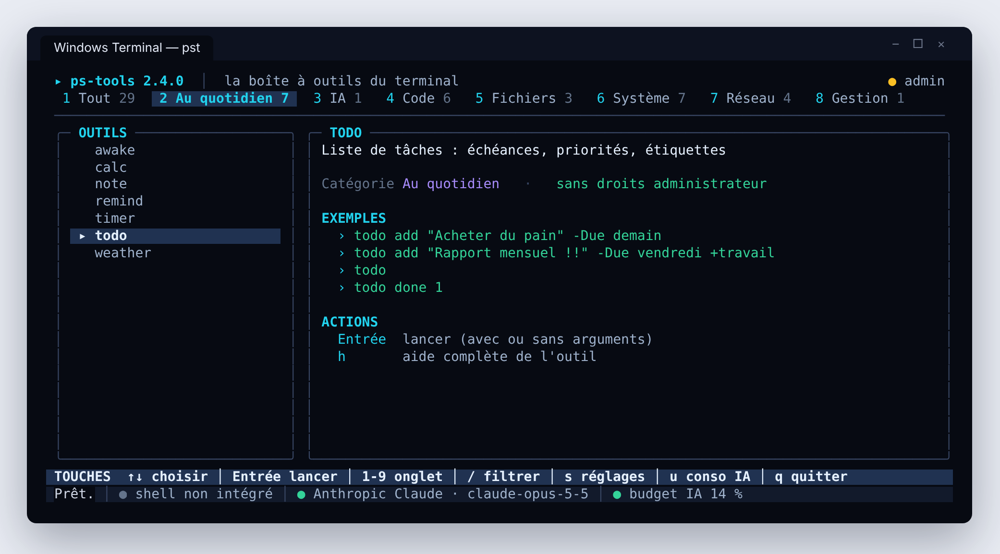
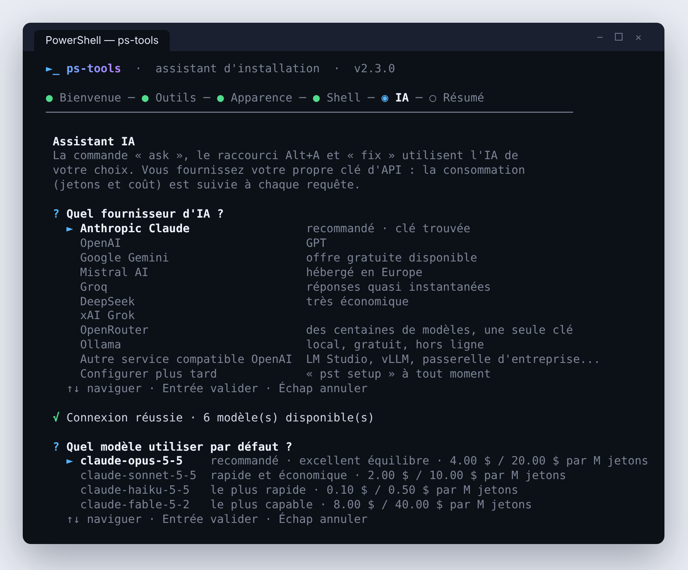
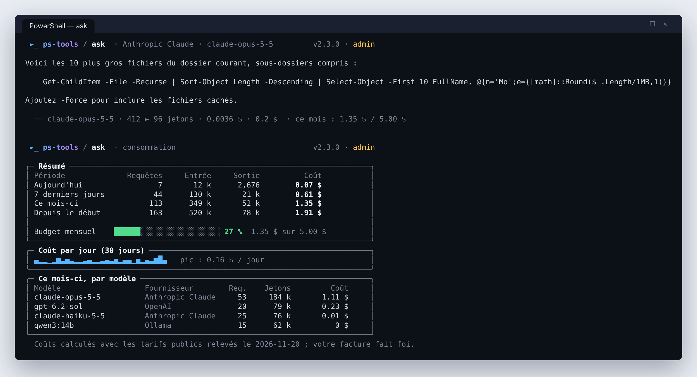
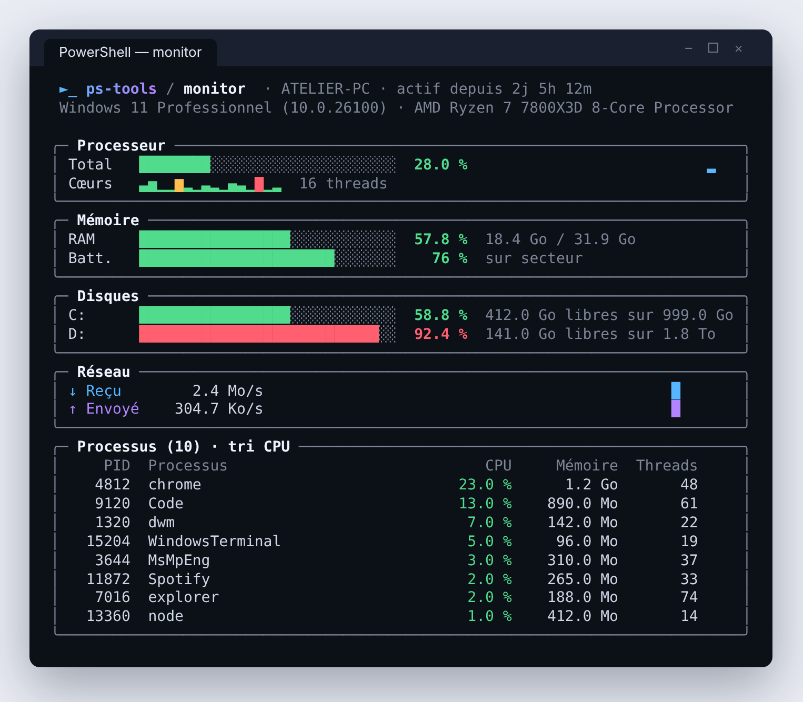
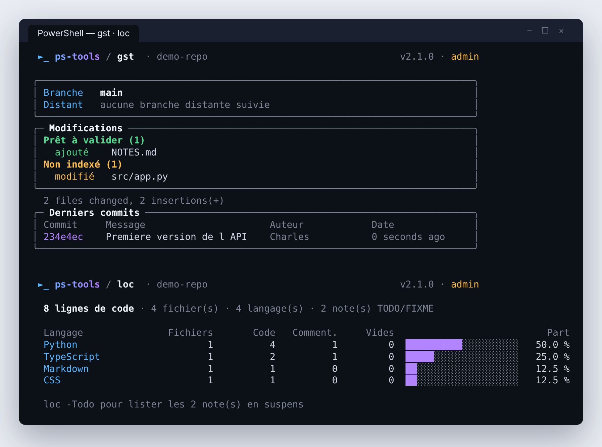
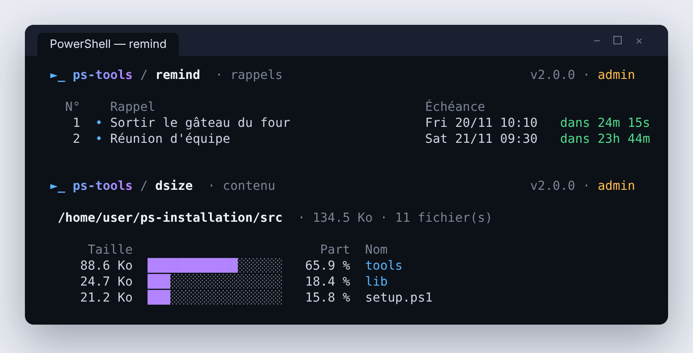

<div align="center">

```
 ██▄         █████▄ ▄█████       ██████ ▄████▄ ▄████▄ ██     ▄█████
  ▀██▄       ██  ██ ██             ██   ██  ██ ██  ██ ██     ██
    ▀██▄     █████▀ ▀████▄ ▄▄▄▄    ██   ██  ██ ██  ██ ██     ▀████▄
  ▄██▀       ██         ██         ██   ██  ██ ██  ██ ██         ██
 ██▀  ▄▄▄▄▄  ██     █████▀         ██   ▀████▀ ▀████▀ ██████ █████▀
```

**La boîte à outils du terminal Windows** · [English version](README.en.md)

Une trentaine de commandes pour la vie de tous les jours et pour le code : tâches, notes, minuteur,
météo, calculatrice, rangement des téléchargements, assistant IA, Git, système, réseau. Un tableau de
bord plein écran, une intégration au shell, **en français ou en anglais**, avec ou sans droits
administrateur.

[](https://github.com/mpgamer75/ps-installation/actions/workflows/ci.yml)


[](LICENSE)



</div>

## Installation

Dans n'importe quel terminal PowerShell, **sans élévation** :

```powershell
irm https://raw.githubusercontent.com/mpgamer75/ps-installation/main/install.ps1 | iex
```

Un assistant vous guide en quelques écrans, et rien n'est modifié avant le récapitulatif final :

| Étape | Ce que vous choisissez |
| --- | --- |
| **Bienvenue** | Vérification de votre environnement (Windows, PowerShell, droits, profil local ou réseau). |
| **Portée** | Pour vous seul ou pour tous les utilisateurs (proposé uniquement en administrateur). |
| **Outils** | Les commandes à installer (toutes cochées par défaut). |
| **Langue** | Français ou English : tous les écrans suivants changent aussitôt. |
| **Apparence** | Thème de couleurs : Cyan (défaut, panneaux sombres façon DefenseClaw), Nuit, Océan, Ambre, Clair (fond blanc) ou Mono. |
| **Shell** | Invite enrichie, raccourcis clavier, commandes façon Unix, avec un correctif guidé si votre profil est bloqué. |
| **IA** | Fournisseur, clé d'API (vérifiée en direct), modèle avec son prix, budget mensuel. |
| **Résumé** | Récapitulatif, retour sur n'importe quelle étape, puis installation. |

`Échap` revient à l'étape précédente. Tout se modifie ensuite avec `pst setup`, et chaque étape
peut être laissée pour plus tard. Les commandes sont utilisables immédiatement, et dans tout nouveau
terminal (PowerShell comme `cmd`).



| Vous lancez l'installation… | Résultat |
| --- | --- |
| en **utilisateur standard** | Installation pour vous seul dans `%LOCALAPPDATA%\ps-tools`, PATH utilisateur. Aucune invite UAC. |
| en **administrateur** | L'installeur vous laisse choisir : pour vous seul, ou pour tous les utilisateurs du PC (`%ProgramFiles%\ps-tools`, PATH machine). |

<details>
<summary>Options d'installation</summary>

```powershell
# Pour tous les utilisateurs (propose l'élévation UAC si nécessaire)
& ([scriptblock]::Create((irm https://raw.githubusercontent.com/mpgamer75/ps-installation/main/install.ps1))) -Scope AllUsers

# Seulement certains outils, sans aucune question
& ([scriptblock]::Create((irm https://raw.githubusercontent.com/mpgamer75/ps-installation/main/install.ps1))) -Tools monitor,ports -Yes

# Depuis un clone du dépôt
git clone https://github.com/mpgamer75/ps-installation
.\ps-installation\install.ps1
```

| Paramètre | Rôle |
| --- | --- |
| `-Scope Auto\|CurrentUser\|AllUsers` | Périmètre d'installation (défaut : `Auto`). Aussi via `$env:PSTOOLS_SCOPE`. |
| `-Tools a,b` | N'installe que les outils cités (`pst` est toujours inclus). |
| `-Yes` | Aucune question ni assistant (installation par défaut). |
| `-NoPath` | Ne modifie pas le PATH. |
| `-Shell` / `-NoShell` | Active l'intégration au shell sans demander / ne touche jamais au profil. |
| `-InstallRoot <dossier>` | Dossier de destination personnalisé. |

</details>

## Intégration au shell

En plus des commandes, ps-tools peut améliorer le terminal lui-même. L'installeur le propose ;
à tout moment :

```powershell
pst shell on     # active (une ligne dans votre profil PowerShell, sans droits administrateur)
pst shell off    # retire
pst keys         # aide-mémoire des raccourcis
```


| Ce que vous gagnez | Détail |
| --- | --- |
| **Invite lisible** | Dossier raccourci, branche Git, durée des commandes longues, échec et code de sortie, badge `admin`. Un nouvel onglet Windows Terminal s'ouvre dans le même dossier. |
| **Historique** | Flèches haut/bas filtrées par ce qui est déjà tapé, menu de complétion sur `Tab`, suggestions en liste (PowerShell 7), lignes contenant un secret non mémorisées. |
| **Raccourcis** | `Alt+A` transforme la phrase tapée en commande (IA) · `Alt+S` ajoute `sudo` · `Alt+C` copie la ligne · `Alt+G` état Git. |
| **Réflexes Unix** | `ll`, `la`, `..`, `...`, `mkcd`, `touch`, `which`, `grep`, `head`, `tail`, `df`, `open`, `sudo`, `reload`. |
| **Favoris** | `mark api` dans un dossier, puis `jump api` (ou `j api`) depuis n'importe où ; `jump -` revient en arrière. |
| **Assistant** | `fix` explique la dernière erreur et propose la commande corrigée. |

L'intégration ne remplace jamais ce que vous avez déjà : une invite personnalisée (oh-my-posh,
starship…) est conservée, et une commande n'est définie que si son nom est libre (Git pour Windows
garde son `grep`). Réglages : `PSTOOLS_NO_PROMPT=1`, `PSTOOLS_NO_ALIASES=1`, `PSTOOLS_NO_KEYS=1`.

## Les outils

Tapez simplement `pst` : le **tableau de bord** classe les outils par onglets (1 Au quotidien,
2 IA, 3 Code…), montre la fiche et les exemples de chacun, et les lance avec `Entrée`. `/` filtre,
`s` ouvre les réglages, `q` quitte.

| Commande | Rôle | Équivalent | Admin |
| --- | --- | --- | --- |
| **Au quotidien** | | | |
| [`todo`](#todo-note-timer) | Liste de tâches : échéances (« demain », « lundi »), priorités, étiquettes | todo.txt | non |
| [`note`](#todo-note-timer) | Notes rapides et journal, un fichier Markdown par jour, recherche | — | non |
| [`timer`](#todo-note-timer) | Minuteur à grands chiffres, chronomètre, Pomodoro, alerte | — | non |
| [`remind`](#remind) | Rappels avec notification Windows, même terminal fermé | `at` | non |
| [`weather`](#weather-math-speed) | Météo actuelle et prévisions à trois jours | wttr.in | non |
| [`math`](#weather-math-speed) | Calculatrice, pourcentages, unités, devises (hors ligne possible) | `bc`, `units` | non |
| [`awake`](#tidy-dupes-awake) | Empêche la mise en veille (présentation, téléchargement) | `caffeinate` | non |
| **IA** | | | |
| [`ask`](#ask) | Assistant IA (Claude, GPT, Gemini, Mistral, Ollama…) : jetons et coût affichés | — | non |
| **Code** | | | |
| [`gst`](#gst-et-loc) | Tableau de bord Git : branche, synchronisation, modifications | `git status` | non |
| [`loc`](#gst-et-loc) | Lignes de code par langage, notes TODO/FIXME | `cloc` | non |
| [`gitignore`](#gitignore-cheat-paths) | Génère et complète le `.gitignore` d'après le projet | gitignore.io | non |
| [`cheat`](#gitignore-cheat-paths) | Exemples prêts à copier d'une commande, hors ligne | `tldr` | non |
| [`serve`](#serve) | Serveur web local instantané pour un dossier | `http.server` | optionnels |
| [`dev`](#dev) | uuid, mots de passe, hash, base64, URL, JSON, JWT, dates | `uuidgen`, `jq`… | non |
| **Fichiers** | | | |
| [`tidy`](#tidy-dupes-awake) | Range un dossier en vrac (Téléchargements) par type ou par mois, avec annulation | — | non |
| [`dupes`](#tidy-dupes-awake) | Trouve les doublons et libère l'espace (corbeille) | `fdupes` | non |
| [`dsize`](#dsize) | Classe le contenu d'un dossier par taille | `du -sh` | optionnels |
| **Système** | | | |
| [`monitor`](#monitor) | Tableau de bord temps réel : CPU, mémoire, disques, réseau, processus | `htop` | non |
| [`sysinfo`](#sysinfo) | Carte d'identité de la machine | `neofetch` | non |
| [`clean`](#clean) | Nettoyeur avec aperçu avant suppression | — | optionnels |
| [`paths`](#gitignore-cheat-paths) | Inspecte et répare le PATH : doublons, dossiers disparus | — | optionnels |
| [`watch`](#watch) | Relance une commande et surligne ce qui change | `watch -d` | non |
| [`logtail`](#logtail) | Suit un journal en direct, couleurs par niveau, filtre | `tail -f` | non |
| [`events`](#events) | Erreurs et avertissements récents de Windows, regroupés | `journalctl` | optionnels |
| **Réseau** | | | |
| [`speed`](#weather-math-speed) | Test de débit avec verdict clair (« OK pour la visio HD ») | speedtest | non |
| [`ping-mon`](#ping-mon) | Latence de plusieurs hôtes : gigue, pertes, historique | `mtr` | non |
| [`netinfo`](#netinfo) | Interfaces, adresses, DNS, Wi-Fi, IP publique | `ip a` | non |
| [`ports`](#ports) | Ports en écoute et processus associés | `ss -ltnp` | optionnels |
| **Gestion** | | | |
| [`pst`](#pst) | Tableau de bord, réglages, raccourcis, intégration au shell, mise à jour | — | non |
| [`pst-uninstall`](#mise-à-jour-et-désinstallation) | Désinstalle ps-tools | — | non |

Chaque commande accepte `-Help` (ou `--help`). « Optionnels » signifie que l'outil fonctionne
entièrement en utilisateur standard et en fait simplement davantage en administrateur.

### todo, note, timer

```powershell
todo add "Acheter du pain" -Due demain          # aussi : lundi, 25/12, +3j ; ! ou !! pour la priorité, +tag
todo                                            # en retard / aujourd'hui / à venir, avec menu interactif
todo done 2
note "Idée : comparer les assurances"           # ajoutée au fichier du jour (Markdown)
note -Search assurance
timer 25m -Label "Thé"                          # grands chiffres, Espace pause, alerte à la fin
timer -Pomodoro
```

### weather, math, speed

```powershell
weather                     # ville devinée, puis mémorisée avec : weather -Set Lyon
math "(12,5 + 7) * 3"       # virgule décimale acceptée ; « math » seul ouvre une calculatrice interactive
math "15% de 80"
math "10 km en mi"
math "100 EUR en USD"       # taux BCE du jour, gardés en cache pour fonctionner hors ligne
speed                       # latence, téléchargement, envoi, verdict en clair
```

### tidy, dupes, awake

```powershell
tidy -DryRun                # aperçu du rangement des Téléchargements par type
tidy                        # Images, Documents, Vidéos, Archives, Installateurs...
tidy -Undo                  # remet tout en place
dupes ~\Pictures -DryRun    # doublons classés par place perdue ; suppression vers la corbeille
awake 2h                    # pas de mise en veille pendant 2 h (Q pour arrêter)
```

### gitignore, cheat, paths

```powershell
gitignore                   # dans un dépôt : propose les modèles d'après les fichiers présents
gitignore node,python -Write
cheat tar                   # exemples tldr (en français quand ils existent), gardés hors ligne
paths                       # chaque entrée du PATH : portée, doublons, dossiers disparus
paths which python          # quelle copie l'emporte
paths clean -DryRun
```

Réseau : `weather` interroge wttr.in, `math` (devises seulement) frankfurter.dev, `speed`
speed.cloudflare.com, `gitignore` toptal.com et `cheat` les pages tldr (GitHub) ; aucun ne demande de clé.

### ask

L'assistant IA du terminal, avec **l'IA de votre choix et votre propre clé d'API**.

```powershell
ask "différence entre Get-ChildItem -Recurse et -Depth ?"
ask -Cmd "les 10 plus gros fichiers de ce dossier"      # propose une commande : exécuter, copier ou annuler
Get-Content .\erreur.log -Tail 80 | ask "que s'est-il passé ?"
git diff | ask -Provider openai "rédige un message de commit"
ask -Usage                                              # consommation : jetons, coût, budget
```



| Fournisseur | Exemples de modèles | Clé |
| --- | --- | --- |
| Anthropic Claude | `claude-opus-5-5`, `claude-sonnet-5-5`, `claude-haiku-5-5`, `claude-fable-5-2` | [platform.claude.com](https://platform.claude.com/) |
| OpenAI | `gpt-6.2-sol`, `gpt-6.2-astra`, `gpt-6.1-terra`, `gpt-6-luna` | [platform.openai.com](https://platform.openai.com/api-keys) |
| Google Gemini | `gemini-4-hydrogen`, `gemini-4-neon`, `gemini-3.8-flash` | [aistudio.google.com](https://aistudio.google.com/apikey) |
| Mistral AI | `mistral-large-4`, `mistral-small-2603` | [console.mistral.ai](https://console.mistral.ai/api-keys) |
| Groq | `openai/gpt-oss-120b`, `openai/gpt-oss-20b` | [console.groq.com](https://console.groq.com/keys) |
| DeepSeek | `deepseek-flash`, `deepseek-v4-pro` | [platform.deepseek.com](https://platform.deepseek.com/api_keys) |
| xAI Grok | `grok-4.3`, `grok-4.7` | [console.x.ai](https://console.x.ai/) |
| OpenRouter | des centaines de modèles, prix lus en direct | [openrouter.ai](https://openrouter.ai/settings/keys) |
| Ollama | vos modèles locaux, gratuit et hors ligne | aucune |
| Compatible OpenAI | LM Studio, vLLM, passerelle d'entreprise… | selon le service |

- **Configuration** : `ask -Setup` (ou `pst setup`). La clé est vérifiée auprès du service, puis
  enregistrée **chiffrée pour votre compte Windows** (DPAPI). Les variables d'environnement
  habituelles (`ANTHROPIC_API_KEY`, `OPENAI_API_KEY`, `GEMINI_API_KEY`…) restent prioritaires.
- **Changer d'IA pour une question** : `ask -Provider mistral "..."`, `ask -Model claude-haiku-5-5 "..."`.
- **Coût** : chaque réponse se termine par une ligne `modèle · jetons entrée ► sortie · coût · durée`,
  et `ask -Usage` affiche le bilan du jour, de la semaine et du mois, le coût par jour et par modèle,
  et la jauge du budget mensuel. Les tarifs sont ceux des pages officielles (relevés le 20/11/2026,
  avec les changements de prix déjà annoncés et les heures de pointe DeepSeek) ; ceux d'OpenRouter
  sont lus en direct. Pour un modèle non référencé, l'assistant vous propose d'en saisir le prix.

> `ask` est le seul outil qui envoie vos données à un service : la question, le texte passé par le
> pipeline et un court contexte (version de Windows et de PowerShell, dossier courant) partent vers
> le fournisseur choisi, et l'usage est facturé sur votre compte. Rien n'est envoyé tant que vous ne
> lancez pas la commande. `ask -Cmd` n'exécute jamais rien sans votre confirmation.

### monitor



```powershell
monitor                      # tableau de bord interactif
monitor -Interval 1 -Top 12  # rafraîchi chaque seconde, 12 processus
monitor -Once                # un instantané, puis retour au prompt
```

Touches : `Q` quitter · `C` tri CPU · `M` tri mémoire · `P` pause · `+`/`-` vitesse.
Affichage sans scintillement, charge par cœur, débit réseau, batterie sur portable.

### sysinfo


```powershell
sysinfo
sysinfo -Json | ConvertFrom-Json   # exploitable dans vos scripts
```

### clean

Analyse d'abord, montre ce qui peut être récupéré, puis supprime **uniquement après confirmation**.

```powershell
clean                           # analyse, sélection par cases à cocher, confirmation
clean -DryRun                   # simulation : ne supprime rien
clean -Only temp,thumbs -Yes    # ciblé et sans question (scripts, tâches planifiées)
clean -Elevate                  # relance en administrateur pour les cibles système
clean -Path D:\Logs -OlderThan 30 -Include *.log   # un dossier précis
```

| Cible | Contenu | Admin |
| --- | --- | --- |
| `temp` | Fichiers temporaires de l'utilisateur | non |
| `browsers` | Caches Chrome, Edge, Firefox | non |
| `thumbs` | Cache des miniatures de l'Explorateur | non |
| `crash` | Rapports d'erreurs et vidages mémoire | non |
| `recycle` | Corbeille (jamais cochée par défaut) | non |
| `wintemp` | Fichiers temporaires de Windows | oui |
| `wupdate` | Téléchargements Windows Update | oui |

Garde-fous : les fichiers en cours d'utilisation sont conservés, les liens et jonctions ne sont pas
suivis, et les dossiers sensibles (profil, lecteur entier, dossiers système) sont refusés.

### watch

```powershell
watch "Get-ChildItem *.log"          # relancé toutes les 2 s, lignes modifiées surlignées
watch -Interval 5 "git status -s"
watch "ports 3000"
```

### logtail

```powershell
logtail .\app.log                              # 20 dernières lignes, puis suivi en direct
logtail C:\logs\api.log -Filter "error|timeout"
logtail app.log -Lines 100 -NoFollow
```

Erreurs en rouge, avertissements en orange, lecture partagée (l'application n'est jamais bloquée),
rotation des journaux gérée. `Espace` insère un repère horodaté.

### events


```powershell
events                      # erreurs et avertissements des dernières 24 h
events -Hours 72 -Level error
events -Id 7031             # message complet d'un événement
```

Un service qui plante quarante fois apparaît sur une seule ligne, avec son compteur. Le journal
Sécurité (`-Log Security`) demande un terminal administrateur.

### gst et loc



```powershell
gst                 # branche, avance/retard, fichiers modifiés, derniers commits
loc                 # lignes de code par langage
loc -Todo           # notes TODO / FIXME avec fichier et ligne
```

`gst` ne modifie jamais le dépôt. `loc` ignore les dépendances et dossiers générés
(`node_modules`, `.git`, `bin`, `obj`, `dist`…).

### serve

```powershell
serve                       # sert le dossier courant sur http://localhost:8080
serve .\dist -Port 3000 -Open
```

Écoute sur `localhost` uniquement : ni droits administrateur, ni règle de pare-feu. `-Lan` ouvre le
serveur au réseau local et demande alors un terminal administrateur.

### dev

```powershell
dev uuid                    dev pass -Length 32 -Copy
dev hash .\setup.exe        dev b64 "bonjour"          dev b64 "Ym9uam91cg==" -Decode
dev url "a b&c"             dev epoch 1767225600
dev jwt <jeton>             Get-Content data.json | dev json
```

Tout est calculé localement. Les mots de passe viennent du générateur cryptographique du système.

### dsize

```powershell
dsize                        # dossier courant
dsize C:\Users\moi -Top 25
dsize D:\Projets -Files      # les plus gros fichiers, tous sous-dossiers confondus
```

### ping-mon

```powershell
ping-mon                           # passerelle, 1.1.1.1, 8.8.8.8, google.com
ping-mon github.com 192.168.1.1    # vos propres hôtes, interrogés en parallèle
ping-mon 1.1.1.1 -Count 20         # 20 mesures puis bilan
```

### netinfo

```powershell
netinfo            # interfaces, DNS, Wi-Fi, connectivité, IP publique
netinfo -Offline   # aucune requête vers Internet
```

> L'adresse IP publique est obtenue par une requête HTTPS vers `api.ipify.org` ; `-Offline` la désactive.
> Avec `ask`, c'est le seul appel externe de la boîte à outils.

### ports


```powershell
ports              # tous les ports TCP en écoute
ports 3000         # qui occupe le port 3000 ?
ports node         # filtre par nom de processus
ports -Kill 8080   # libère le port (avec confirmation)
```

La colonne « Portée » distingue les services joignables depuis le réseau de ceux limités à la machine.

### remind



```powershell
remind add "Sortir le gâteau du four" -In 25m
remind add "Réunion d'équipe" -At "demain 9:30"
remind add "Renouveler le domaine" -At "25/12/2026 09:00"
remind list
remind done 1
remind            # menu interactif
```

Les rappels passent par le Planificateur de tâches **de l'utilisateur courant** : pas de droits
administrateur, et la notification s'affiche même terminal fermé.

### pst

```powershell
pst             # tableau de bord plein écran (liste simple si le terminal n'est pas interactif)
pst list        # liste des outils
pst setup       # réglages : langue, apparence, intégration au shell, assistant IA
pst usage       # consommation de l'assistant IA
pst keys        # aide-mémoire des raccourcis
pst shell on    # intégration au shell
pst doctor      # vérifie l'installation, le PATH, le terminal
pst update      # installe la dernière version
```

## Français ou anglais

Toute l'interface existe en français et en anglais : outils, aide, tableau de bord, assistant
d'installation, intégration au shell. La langue est choisie à la première étape de l'installation,
se change avec `pst setup`, et suit sinon la langue de Windows. Pour une session :
`$env:PSTOOLS_LANG = 'en'`.

## Avec ou sans droits administrateur

| | Utilisateur standard | Administrateur |
| --- | --- | --- |
| Installation, mise à jour, désinstallation | oui (pour soi) | oui (pour soi ou pour tous) |
| `monitor`, `sysinfo`, `ping-mon`, `netinfo`, `remind`, `ask`, `watch`, `logtail`, `gst`, `loc`, `dev` | complet | complet |
| Intégration au shell | oui | oui |
| `events` | journaux Système et Application | + journal Sécurité |
| `serve` | sur `localhost` | + ouverture au réseau local (`-Lan`) |
| `clean` | cibles utilisateur | + temporaires Windows et Windows Update |
| `dsize` | dossiers accessibles (les autres sont signalés) | tous les dossiers |
| `ports` | liste complète ; arrêt de vos propres processus | + arrêt des processus d'autres comptes |

Aucun outil ne s'arrête faute de droits : ce qui demande une élévation est signalé clairement.

## Configuration requise

- Windows 10 ou 11
- Windows PowerShell 5.1 (préinstallé) ou PowerShell 7+
- [Windows Terminal](https://aka.ms/terminal) recommandé pour le meilleur rendu ; la console classique fonctionne aussi

| Variable | Effet |
| --- | --- |
| `NO_COLOR=1` | Désactive les couleurs |
| `PSTOOLS_ASCII=1` | Remplace les caractères de dessin par de l'ASCII (polices anciennes) |
| `ANTHROPIC_API_KEY`, `OPENAI_API_KEY`, `GEMINI_API_KEY`, `MISTRAL_API_KEY`, `GROQ_API_KEY`, `DEEPSEEK_API_KEY`, `XAI_API_KEY`, `OPENROUTER_API_KEY` | Clés utilisées par `ask` (prioritaires sur celles de `ask -Setup`) |
| `PSTOOLS_THEME` | Thème pour la session : `cyan`, `nuit`, `ocean`, `ambre`, `clair`, `mono` |
| `PSTOOLS_LANG` | Langue pour la session : `fr` ou `en` |

## Mise à jour et désinstallation

```powershell
pst update        # installe la dernière version
pst-uninstall     # désinstalle ps-tools
```

`pst-uninstall` retire tout ce que l'installation a posé : les commandes, l'entrée du PATH,
l'intégration au shell (le bloc ajouté à votre profil) et les rappels planifiés. Une installation
pour votre compte se retire sans droits administrateur ; une installation « tous les utilisateurs »
propose l'élévation.

| Option | Effet |
| --- | --- |
| `pst-uninstall` | Demande confirmation, puis demande s'il faut aussi supprimer vos données. |
| `pst-uninstall -Yes` | Aucune question ; vos données (rappels, favoris, réglages de `ask`) sont conservées. |
| `pst-uninstall -Yes -Purge` | Aucune question ; supprime aussi vos données. Il ne reste rien. |

Si les commandes ne sont plus accessibles, la même désinstallation se lance depuis le web :

```powershell
irm https://raw.githubusercontent.com/mpgamer75/ps-installation/main/uninstall.ps1 | iex
```

Une installation de la version 1 est détectée et retirée elle aussi (son retrait de
`C:\Program Files` demande un terminal administrateur, une seule fois).

## Dépannage

| Symptôme | Solution |
| --- | --- |
| Commande introuvable après l'installation | Ouvrez un nouveau terminal, puis `pst doctor`. |
| Erreur rouge au démarrage : « profile.ps1 n'est pas signé numériquement » | Voir [Profil sur un partage réseau](#profil-sur-un-partage-réseau) : `pst update` puis `pst shell on`. |
| Caractères étranges à la place des cadres | Utilisez Windows Terminal, ou définissez `PSTOOLS_ASCII=1`. |
| « L'exécution de scripts est désactivée » | Sans effet sur les commandes installées (elles passent par des lanceurs `.cmd`). Pour lancer `install.ps1` depuis un clone : `powershell -ExecutionPolicy Bypass -File .\install.ps1`. |
| Échec du téléchargement (proxy d'entreprise) | Clonez le dépôt et lancez `.\install.ps1`. |

### Profil sur un partage réseau

En entreprise, le dossier « Documents » est souvent redirigé vers un serveur
(`\\serveur\users\...\Documents`). Le profil PowerShell s'y trouve aussi, et Windows traite alors
ce fichier comme venant d'Internet : avec la stratégie `RemoteSigned`, il exige une signature et
affiche à chaque ouverture du terminal l'erreur « n'est pas signé numériquement ».

ps-tools ne se fie plus à la stratégie affichée : il **teste réellement le chargement** du profil
avant d'y écrire. Un profil bloqué n'est jamais modifié (le bloc d'une version précédente en est
même retiré), donc plus aucune erreur au démarrage. `pst shell on` (ou l'assistant) propose alors :

| Solution | Effet | Annulation |
| --- | --- | --- |
| **Faire confiance au partage** (recommandé) | Classe ce serveur de fichiers en zone « Intranet local » pour votre compte : ses scripts sont traités comme locaux. | `pst shell off` |
| Autoriser les scripts non signés | Stratégie `Bypass` pour votre compte uniquement. | `pst shell off` (stratégie précédente rétablie) |
| Profil Windows Terminal « ps-tools » | Un onglet dédié charge l'intégration depuis l'installation locale, sans toucher au partage ni à la stratégie. | `pst shell off` |

Aucune de ces solutions ne demande de droits administrateur. Si votre service informatique impose
ces réglages par stratégie de groupe, l'outil le détecte et le dit ; le profil Windows Terminal reste
alors la solution. `pst doctor` signale un profil bloqué.

## Développement

```
install.ps1 / uninstall.ps1   amorces en ASCII pur (compatibles « irm | iex »)
manifest.json                 liste des outils et version
src/lib/PsTools.ps1           bibliothèque partagée : thèmes, cadres, menus, configuration, profil
src/lib/PsTools.AI.ps1        assistant IA : fournisseurs, prix, flux, consommation
src/lib/PsTools.Wizard.ps1    assistant d'installation et « pst setup »
src/setup.ps1                 moteur d'installation et de désinstallation
src/shell/PsTools.Shell.ps1   intégration au shell : invite, raccourcis, alias, favoris
src/tools/*.ps1               un fichier par commande
src/i18n/en/*.psd1            dictionnaires anglais (le texte français sert de clé)
tests/                        tests Pester, données simulées, faux service d'IA (Python)
```

```powershell
Invoke-Pester ./tests                                                         # tests
Invoke-ScriptAnalyzer -Path ./src -Recurse -Settings ./PSScriptAnalyzerSettings.psd1   # analyse statique
pwsh -File build/Add-Bom.ps1                                                  # encodage UTF-8 avec BOM de src/ et tests/
```

L'intégration continue exécute l'analyse statique, les tests sous Windows PowerShell 5.1 et
PowerShell 7, puis une installation complète suivie de chaque outil sur une vraie machine Windows.

Pour ajouter un outil : créez `src/tools/<nom>.ps1` (chargez la bibliothèque en première ligne, comme
les outils existants), déclarez-le dans `manifest.json`, ajoutez un test. Les contributions sont les
bienvenues, voir le [journal des modifications](CHANGELOG.md).

## Licence

[MIT](LICENSE) — Charles L.
