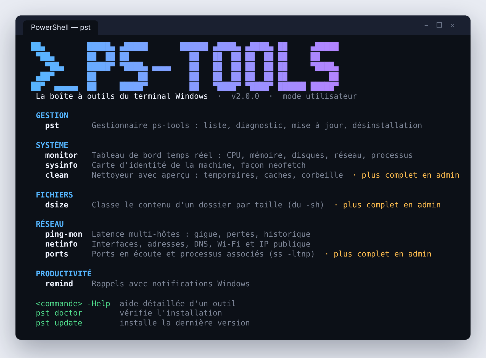

<div align="center">

```
 ██▄         █████▄ ▄█████       ██████ ▄████▄ ▄████▄ ██     ▄█████
  ▀██▄       ██  ██ ██             ██   ██  ██ ██  ██ ██     ██
    ▀██▄     █████▀ ▀████▄ ▄▄▄▄    ██   ██  ██ ██  ██ ██     ▀████▄
  ▄██▀       ██         ██         ██   ██  ██ ██  ██ ██         ██
 ██▀  ▄▄▄▄▄  ██     █████▀         ██   ▀████▀ ▀████▀ ██████ █████▀
```

**La boîte à outils du terminal Windows**

Neuf commandes soignées qui apportent à PowerShell le confort des terminaux Linux et macOS.
Installation en une ligne, **avec ou sans droits administrateur**.

[](https://github.com/mpgamer75/ps-installation/actions/workflows/ci.yml)


[](LICENSE)



</div>

## Installation

Dans n'importe quel terminal PowerShell, **sans élévation** :

```powershell
irm https://raw.githubusercontent.com/mpgamer75/ps-installation/main/install.ps1 | iex
```

Les commandes sont utilisables immédiatement, et dans tout nouveau terminal (PowerShell comme `cmd`).

| Vous lancez l'installation… | Résultat |
| --- | --- |
| en **utilisateur standard** | Installation pour vous seul dans `%LOCALAPPDATA%\ps-tools`, PATH utilisateur. Aucune invite UAC. |
| en **administrateur** | L'installeur vous laisse choisir : pour vous seul, ou pour tous les utilisateurs du PC (`%ProgramFiles%\ps-tools`, PATH machine). |

<details>
<summary>Options d'installation</summary>

```powershell
# Pour tous les utilisateurs (propose l'élévation UAC si nécessaire)
& ([scriptblock]::Create((irm https://raw.githubusercontent.com/mpgamer75/ps-installation/main/install.ps1))) -Scope AllUsers

# Seulement certains outils, sans aucune question
& ([scriptblock]::Create((irm https://raw.githubusercontent.com/mpgamer75/ps-installation/main/install.ps1))) -Tools monitor,ports -Yes

# Depuis un clone du dépôt
git clone https://github.com/mpgamer75/ps-installation
.\ps-installation\install.ps1
```

| Paramètre | Rôle |
| --- | --- |
| `-Scope Auto\|CurrentUser\|AllUsers` | Périmètre d'installation (défaut : `Auto`). Aussi via `$env:PSTOOLS_SCOPE`. |
| `-Tools a,b` | N'installe que les outils cités (`pst` est toujours inclus). |
| `-Yes` | Aucune question. |
| `-NoPath` | Ne modifie pas le PATH. |
| `-InstallRoot <dossier>` | Dossier de destination personnalisé. |

</details>

## Les outils

| Commande | Rôle | Équivalent Unix | Droits admin |
| --- | --- | --- | --- |
| [`monitor`](#monitor) | Tableau de bord temps réel : CPU, mémoire, disques, réseau, processus | `htop` | non |
| [`sysinfo`](#sysinfo) | Carte d'identité de la machine | `neofetch` | non |
| [`clean`](#clean) | Nettoyeur avec aperçu avant suppression | — | optionnels |
| [`dsize`](#dsize) | Classe le contenu d'un dossier par taille | `du -sh * \| sort -h` | optionnels |
| [`ping-mon`](#ping-mon) | Latence de plusieurs hôtes : gigue, pertes, historique | `mtr`, `gping` | non |
| [`netinfo`](#netinfo) | Interfaces, adresses, DNS, Wi-Fi, IP publique | `ip a` | non |
| [`ports`](#ports) | Ports en écoute et processus associés | `ss -ltnp`, `lsof -i` | optionnels |
| [`remind`](#remind) | Rappels avec notifications Windows | `at` | non |
| [`pst`](#pst) | Gestionnaire : liste, diagnostic, mise à jour, désinstallation | — | non |

Chaque commande accepte `-Help` (ou `--help`). « Optionnels » signifie que l'outil fonctionne
entièrement en utilisateur standard et en fait simplement davantage en administrateur.

### monitor


```powershell
monitor                      # tableau de bord interactif
monitor -Interval 1 -Top 12  # rafraîchi chaque seconde, 12 processus
monitor -Once                # un instantané, puis retour au prompt
```

Touches : `Q` quitter · `C` tri CPU · `M` tri mémoire · `P` pause · `+`/`-` vitesse.
Affichage sans scintillement, charge par cœur, débit réseau, batterie sur portable.

### sysinfo


```powershell
sysinfo
sysinfo -Json | ConvertFrom-Json   # exploitable dans vos scripts
```

### clean

Analyse d'abord, montre ce qui peut être récupéré, puis supprime **uniquement après confirmation**.

```powershell
clean                           # analyse, sélection par cases à cocher, confirmation
clean -DryRun                   # simulation : ne supprime rien
clean -Only temp,thumbs -Yes    # ciblé et sans question (scripts, tâches planifiées)
clean -Elevate                  # relance en administrateur pour les cibles système
clean -Path D:\Logs -OlderThan 30 -Include *.log   # un dossier précis
```

| Cible | Contenu | Admin |
| --- | --- | --- |
| `temp` | Fichiers temporaires de l'utilisateur | non |
| `browsers` | Caches Chrome, Edge, Firefox | non |
| `thumbs` | Cache des miniatures de l'Explorateur | non |
| `crash` | Rapports d'erreurs et vidages mémoire | non |
| `recycle` | Corbeille (jamais cochée par défaut) | non |
| `wintemp` | Fichiers temporaires de Windows | oui |
| `wupdate` | Téléchargements Windows Update | oui |

Garde-fous : les fichiers en cours d'utilisation sont conservés, les liens et jonctions ne sont pas
suivis, et les dossiers sensibles (profil, lecteur entier, dossiers système) sont refusés.

### dsize

```powershell
dsize                        # dossier courant
dsize C:\Users\moi -Top 25
dsize D:\Projets -Files      # les plus gros fichiers, tous sous-dossiers confondus
```

### ping-mon

```powershell
ping-mon                           # passerelle, 1.1.1.1, 8.8.8.8, google.com
ping-mon github.com 192.168.1.1    # vos propres hôtes, interrogés en parallèle
ping-mon 1.1.1.1 -Count 20         # 20 mesures puis bilan
```

### netinfo

```powershell
netinfo            # interfaces, DNS, Wi-Fi, connectivité, IP publique
netinfo -Offline   # aucune requête vers Internet
```

> L'adresse IP publique est obtenue par une requête HTTPS vers `api.ipify.org`. C'est le seul appel
> externe de toute la boîte à outils ; `-Offline` le désactive.

### ports


```powershell
ports              # tous les ports TCP en écoute
ports 3000         # qui occupe le port 3000 ?
ports node         # filtre par nom de processus
ports -Kill 8080   # libère le port (avec confirmation)
```

La colonne « Portée » distingue les services joignables depuis le réseau de ceux limités à la machine.

### remind


```powershell
remind add "Sortir le gâteau du four" -In 25m
remind add "Réunion d'équipe" -At "demain 9:30"
remind add "Renouveler le domaine" -At "25/12/2026 09:00"
remind list
remind done 1
remind            # menu interactif
```

Les rappels passent par le Planificateur de tâches **de l'utilisateur courant** : pas de droits
administrateur, et la notification s'affiche même terminal fermé.

### pst

```powershell
pst             # logo et liste des outils
pst doctor      # vérifie l'installation, le PATH, le terminal
pst update      # installe la dernière version
pst uninstall   # désinstalle
```

## Avec ou sans droits administrateur

| | Utilisateur standard | Administrateur |
| --- | --- | --- |
| Installation, mise à jour, désinstallation | oui (pour soi) | oui (pour soi ou pour tous) |
| `monitor`, `sysinfo`, `ping-mon`, `netinfo`, `remind` | complet | complet |
| `clean` | cibles utilisateur | + temporaires Windows et Windows Update |
| `dsize` | dossiers accessibles (les autres sont signalés) | tous les dossiers |
| `ports` | liste complète ; arrêt de vos propres processus | + arrêt des processus d'autres comptes |

Aucun outil ne s'arrête faute de droits : ce qui demande une élévation est signalé clairement.

## Configuration requise

- Windows 10 ou 11
- Windows PowerShell 5.1 (préinstallé) ou PowerShell 7+
- [Windows Terminal](https://aka.ms/terminal) recommandé pour le meilleur rendu ; la console classique fonctionne aussi

| Variable | Effet |
| --- | --- |
| `NO_COLOR=1` | Désactive les couleurs |
| `PSTOOLS_ASCII=1` | Remplace les caractères de dessin par de l'ASCII (polices anciennes) |

## Mise à jour et désinstallation

```powershell
pst update
pst uninstall
```

Ou, sans passer par `pst` :

```powershell
irm https://raw.githubusercontent.com/mpgamer75/ps-installation/main/uninstall.ps1 | iex
```

La désinstallation retire les fichiers, l'entrée du PATH et les rappels planifiés ; elle demande avant
de supprimer vos rappels enregistrés. Une installation de la version 1 est détectée et remplacée
(son retrait de `C:\Program Files` demande un terminal administrateur, une seule fois).

## Dépannage

| Symptôme | Solution |
| --- | --- |
| Commande introuvable après l'installation | Ouvrez un nouveau terminal, puis `pst doctor`. |
| Caractères étranges à la place des cadres | Utilisez Windows Terminal, ou définissez `PSTOOLS_ASCII=1`. |
| « L'exécution de scripts est désactivée » | Sans effet sur les commandes installées (elles passent par des lanceurs `.cmd`). Pour lancer `install.ps1` depuis un clone : `powershell -ExecutionPolicy Bypass -File .\install.ps1`. |
| Échec du téléchargement (proxy d'entreprise) | Clonez le dépôt et lancez `.\install.ps1`. |

## Développement

```
install.ps1 / uninstall.ps1   amorces en ASCII pur (compatibles « irm | iex »)
manifest.json                 liste des outils et version
src/lib/PsTools.ps1           bibliothèque partagée : couleurs, cadres, menus, écran temps réel
src/setup.ps1                 moteur d'installation et de désinstallation
src/tools/*.ps1               un fichier par commande
tests/                        tests Pester et données simulées
```

```powershell
Invoke-Pester ./tests                                                         # tests
Invoke-ScriptAnalyzer -Path ./src -Recurse -Settings ./PSScriptAnalyzerSettings.psd1   # analyse statique
pwsh -File build/Add-Bom.ps1                                                  # encodage UTF-8 avec BOM de src/ et tests/
```

L'intégration continue exécute l'analyse statique, les tests sous Windows PowerShell 5.1 et
PowerShell 7, puis une installation complète suivie de chaque outil sur une vraie machine Windows.

Pour ajouter un outil : créez `src/tools/<nom>.ps1` (chargez la bibliothèque en première ligne, comme
les outils existants), déclarez-le dans `manifest.json`, ajoutez un test. Les contributions sont les
bienvenues, voir le [journal des modifications](CHANGELOG.md).

## Licence

[MIT](LICENSE) — Charles L.
