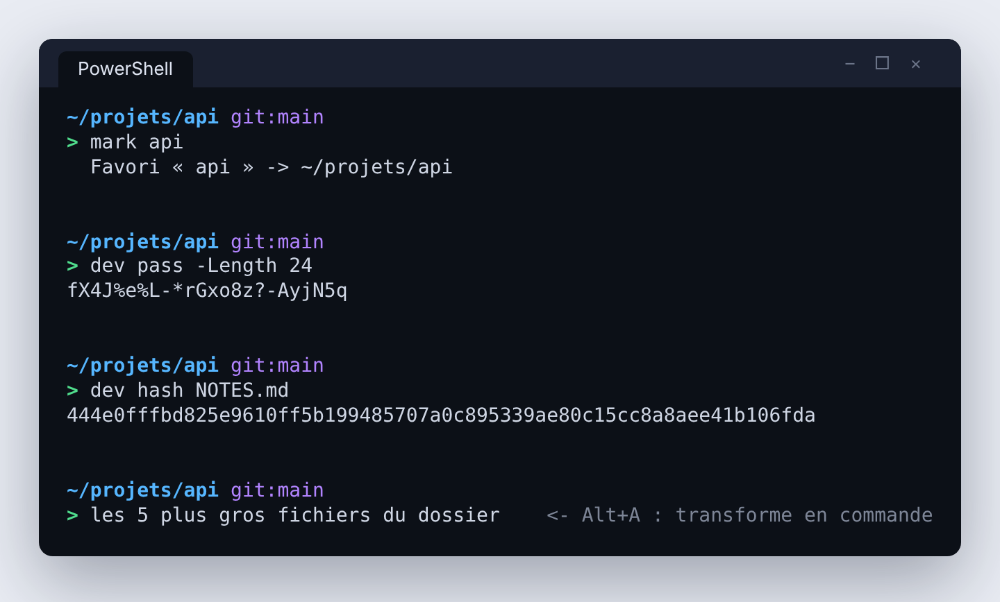
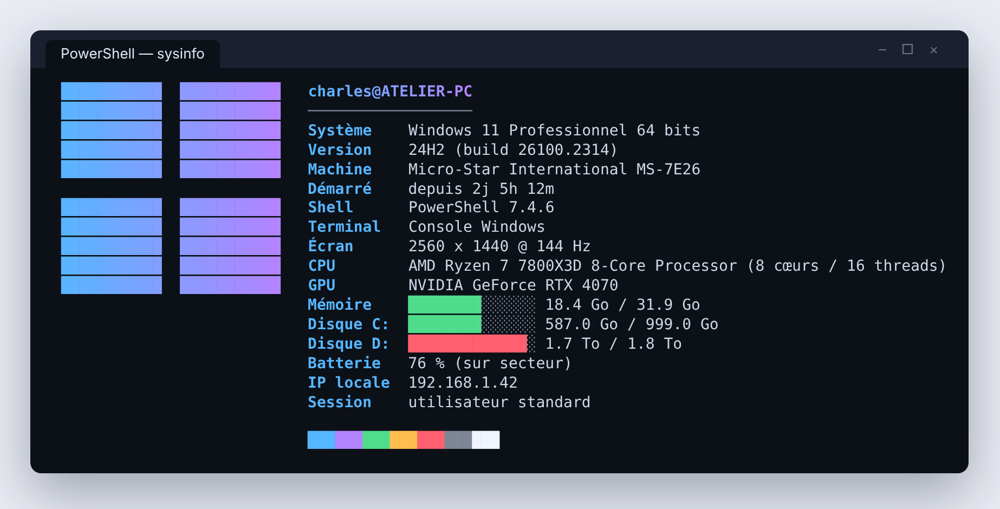
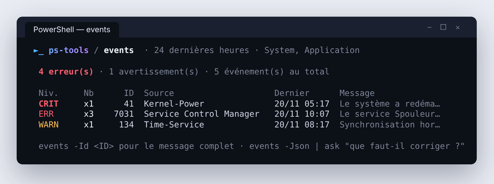
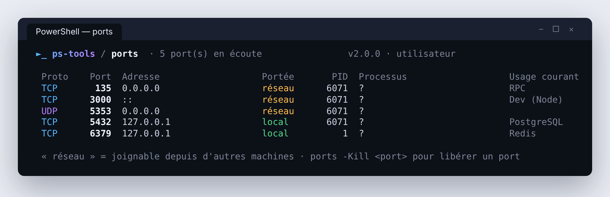

<div align="center">

```
 ██▄         █████▄ ▄█████       ██████ ▄████▄ ▄████▄ ██     ▄█████
  ▀██▄       ██  ██ ██             ██   ██  ██ ██  ██ ██     ██
    ▀██▄     █████▀ ▀████▄ ▄▄▄▄    ██   ██  ██ ██  ██ ██     ▀████▄
  ▄██▀       ██         ██         ██   ██  ██ ██  ██ ██         ██
 ██▀  ▄▄▄▄▄  ██     █████▀         ██   ▀████▀ ▀████▀ ██████ █████▀
```

**La boîte à outils du terminal Windows**

Dix-huit commandes et une intégration au shell qui apportent à PowerShell le confort des terminaux
Linux et macOS : assistant IA, observation, outils de développement, raccourcis.
Installation en une ligne, **avec ou sans droits administrateur**.

[](https://github.com/mpgamer75/ps-installation/actions/workflows/ci.yml)


[](LICENSE)


</div>

## Installation

Dans n'importe quel terminal PowerShell, **sans élévation** :

```powershell
irm https://raw.githubusercontent.com/mpgamer75/ps-installation/main/install.ps1 | iex
```

Les commandes sont utilisables immédiatement, et dans tout nouveau terminal (PowerShell comme `cmd`).

| Vous lancez l'installation… | Résultat |
| --- | --- |
| en **utilisateur standard** | Installation pour vous seul dans `%LOCALAPPDATA%\ps-tools`, PATH utilisateur. Aucune invite UAC. |
| en **administrateur** | L'installeur vous laisse choisir : pour vous seul, ou pour tous les utilisateurs du PC (`%ProgramFiles%\ps-tools`, PATH machine). |

<details>
<summary>Options d'installation</summary>

```powershell
# Pour tous les utilisateurs (propose l'élévation UAC si nécessaire)
& ([scriptblock]::Create((irm https://raw.githubusercontent.com/mpgamer75/ps-installation/main/install.ps1))) -Scope AllUsers

# Seulement certains outils, sans aucune question
& ([scriptblock]::Create((irm https://raw.githubusercontent.com/mpgamer75/ps-installation/main/install.ps1))) -Tools monitor,ports -Yes

# Depuis un clone du dépôt
git clone https://github.com/mpgamer75/ps-installation
.\ps-installation\install.ps1
```

| Paramètre | Rôle |
| --- | --- |
| `-Scope Auto\|CurrentUser\|AllUsers` | Périmètre d'installation (défaut : `Auto`). Aussi via `$env:PSTOOLS_SCOPE`. |
| `-Tools a,b` | N'installe que les outils cités (`pst` est toujours inclus). |
| `-Yes` | Aucune question. |
| `-NoPath` | Ne modifie pas le PATH. |
| `-Shell` / `-NoShell` | Active l'intégration au shell sans demander / ne touche jamais au profil. |
| `-InstallRoot <dossier>` | Dossier de destination personnalisé. |

</details>

## Intégration au shell

En plus des commandes, ps-tools peut améliorer le terminal lui-même. L'installeur le propose ;
à tout moment :

```powershell
pst shell on     # active (une ligne dans votre profil PowerShell, sans droits administrateur)
pst shell off    # retire
pst keys         # aide-mémoire des raccourcis
```



| Ce que vous gagnez | Détail |
| --- | --- |
| **Invite lisible** | Dossier raccourci, branche Git, durée des commandes longues, échec et code de sortie, badge `admin`. Un nouvel onglet Windows Terminal s'ouvre dans le même dossier. |
| **Historique** | Flèches haut/bas filtrées par ce qui est déjà tapé, menu de complétion sur `Tab`, suggestions en liste (PowerShell 7), lignes contenant un secret non mémorisées. |
| **Raccourcis** | `Alt+A` transforme la phrase tapée en commande (IA) · `Alt+S` ajoute `sudo` · `Alt+C` copie la ligne · `Alt+G` état Git. |
| **Réflexes Unix** | `ll`, `la`, `..`, `...`, `mkcd`, `touch`, `which`, `grep`, `head`, `tail`, `df`, `open`, `sudo`, `reload`. |
| **Favoris** | `mark api` dans un dossier, puis `jump api` (ou `j api`) depuis n'importe où ; `jump -` revient en arrière. |
| **Assistant** | `fix` explique la dernière erreur et propose la commande corrigée. |

L'intégration ne remplace jamais ce que vous avez déjà : une invite personnalisée (oh-my-posh,
starship…) est conservée, et une commande n'est définie que si son nom est libre (Git pour Windows
garde son `grep`). Réglages : `PSTOOLS_NO_PROMPT=1`, `PSTOOLS_NO_ALIASES=1`, `PSTOOLS_NO_KEYS=1`.

## Les outils

| Commande | Rôle | Équivalent Unix | Droits admin |
| --- | --- | --- | --- |
| **IA** | | | |
| [`ask`](#ask) | Assistant Claude : questions, commandes, analyse de sorties | — | non |
| **Système** | | | |
| [`monitor`](#monitor) | Tableau de bord temps réel : CPU, mémoire, disques, réseau, processus | `htop` | non |
| [`sysinfo`](#sysinfo) | Carte d'identité de la machine | `neofetch` | non |
| [`clean`](#clean) | Nettoyeur avec aperçu avant suppression | — | optionnels |
| **Observation** | | | |
| [`watch`](#watch) | Relance une commande et surligne ce qui change | `watch -d` | non |
| [`logtail`](#logtail) | Suit un journal en direct, couleurs par niveau, filtre | `tail -f` | non |
| [`events`](#events) | Erreurs et avertissements récents de Windows, regroupés | `journalctl -p err` | optionnels |
| **Code** | | | |
| [`gst`](#gst-et-loc) | Tableau de bord Git : branche, synchronisation, modifications | `git status` + `log` | non |
| [`loc`](#gst-et-loc) | Lignes de code par langage, notes TODO/FIXME | `cloc`, `tokei` | non |
| [`serve`](#serve) | Serveur web local instantané pour un dossier | `python -m http.server` | optionnels |
| [`dev`](#dev) | uuid, mots de passe, hash, base64, URL, JSON, JWT, dates | `uuidgen`, `sha256sum`, `jq`… | non |
| **Fichiers et réseau** | | | |
| [`dsize`](#dsize) | Classe le contenu d'un dossier par taille | `du -sh * \| sort -h` | optionnels |
| [`ping-mon`](#ping-mon) | Latence de plusieurs hôtes : gigue, pertes, historique | `mtr`, `gping` | non |
| [`netinfo`](#netinfo) | Interfaces, adresses, DNS, Wi-Fi, IP publique | `ip a` | non |
| [`ports`](#ports) | Ports en écoute et processus associés | `ss -ltnp`, `lsof -i` | optionnels |
| **Productivité** | | | |
| [`remind`](#remind) | Rappels avec notifications Windows | `at` | non |
| [`pst`](#pst) | Menu, aide-mémoire, intégration au shell, diagnostic, mise à jour | — | non |
| [`pst-uninstall`](#mise-à-jour-et-désinstallation) | Désinstalle ps-tools | — | non |

Chaque commande accepte `-Help` (ou `--help`). « Optionnels » signifie que l'outil fonctionne
entièrement en utilisateur standard et en fait simplement davantage en administrateur.

### ask

L'assistant IA du terminal, propulsé par Claude.

```powershell
ask "différence entre Get-ChildItem -Recurse et -Depth ?"
ask -Cmd "les 10 plus gros fichiers de ce dossier"      # propose une commande : exécuter, copier ou annuler
Get-Content .\erreur.log -Tail 80 | ask "que s'est-il passé ?"
git diff | ask "rédige un message de commit"
events -Json | ask "y a-t-il un problème sérieux ?"
```

Configuration, une fois : `ask -Setup` (ou la variable `ANTHROPIC_API_KEY`). La clé se crée sur
[platform.claude.com](https://platform.claude.com/) ; elle est enregistrée chiffrée pour votre compte
Windows. Modèle par défaut : `claude-opus-5-5`, modifiable avec `-Model` ou `ask -Setup`.

> `ask` est le seul outil qui envoie vos données à un service : la question, le texte passé par le
> pipeline et un court contexte (version de Windows et de PowerShell, dossier courant) partent vers
> l'API d'Anthropic, et l'usage est facturé sur votre compte. Rien n'est envoyé tant que vous ne
> lancez pas la commande. `ask -Cmd` n'exécute jamais rien sans votre confirmation.

### monitor


```powershell
monitor                      # tableau de bord interactif
monitor -Interval 1 -Top 12  # rafraîchi chaque seconde, 12 processus
monitor -Once                # un instantané, puis retour au prompt
```

Touches : `Q` quitter · `C` tri CPU · `M` tri mémoire · `P` pause · `+`/`-` vitesse.
Affichage sans scintillement, charge par cœur, débit réseau, batterie sur portable.

### sysinfo



```powershell
sysinfo
sysinfo -Json | ConvertFrom-Json   # exploitable dans vos scripts
```

### clean

Analyse d'abord, montre ce qui peut être récupéré, puis supprime **uniquement après confirmation**.

```powershell
clean                           # analyse, sélection par cases à cocher, confirmation
clean -DryRun                   # simulation : ne supprime rien
clean -Only temp,thumbs -Yes    # ciblé et sans question (scripts, tâches planifiées)
clean -Elevate                  # relance en administrateur pour les cibles système
clean -Path D:\Logs -OlderThan 30 -Include *.log   # un dossier précis
```

| Cible | Contenu | Admin |
| --- | --- | --- |
| `temp` | Fichiers temporaires de l'utilisateur | non |
| `browsers` | Caches Chrome, Edge, Firefox | non |
| `thumbs` | Cache des miniatures de l'Explorateur | non |
| `crash` | Rapports d'erreurs et vidages mémoire | non |
| `recycle` | Corbeille (jamais cochée par défaut) | non |
| `wintemp` | Fichiers temporaires de Windows | oui |
| `wupdate` | Téléchargements Windows Update | oui |

Garde-fous : les fichiers en cours d'utilisation sont conservés, les liens et jonctions ne sont pas
suivis, et les dossiers sensibles (profil, lecteur entier, dossiers système) sont refusés.

### watch

```powershell
watch "Get-ChildItem *.log"          # relancé toutes les 2 s, lignes modifiées surlignées
watch -Interval 5 "git status -s"
watch "ports 3000"
```

### logtail

```powershell
logtail .\app.log                              # 20 dernières lignes, puis suivi en direct
logtail C:\logs\api.log -Filter "error|timeout"
logtail app.log -Lines 100 -NoFollow
```

Erreurs en rouge, avertissements en orange, lecture partagée (l'application n'est jamais bloquée),
rotation des journaux gérée. `Espace` insère un repère horodaté.

### events



```powershell
events                      # erreurs et avertissements des dernières 24 h
events -Hours 72 -Level error
events -Id 7031             # message complet d'un événement
```

Un service qui plante quarante fois apparaît sur une seule ligne, avec son compteur. Le journal
Sécurité (`-Log Security`) demande un terminal administrateur.

### gst et loc


```powershell
gst                 # branche, avance/retard, fichiers modifiés, derniers commits
loc                 # lignes de code par langage
loc -Todo           # notes TODO / FIXME avec fichier et ligne
```

`gst` ne modifie jamais le dépôt. `loc` ignore les dépendances et dossiers générés
(`node_modules`, `.git`, `bin`, `obj`, `dist`…).

### serve

```powershell
serve                       # sert le dossier courant sur http://localhost:8080
serve .\dist -Port 3000 -Open
```

Écoute sur `localhost` uniquement : ni droits administrateur, ni règle de pare-feu. `-Lan` ouvre le
serveur au réseau local et demande alors un terminal administrateur.

### dev

```powershell
dev uuid                    dev pass -Length 32 -Copy
dev hash .\setup.exe        dev b64 "bonjour"          dev b64 "Ym9uam91cg==" -Decode
dev url "a b&c"             dev epoch 1767225600
dev jwt <jeton>             Get-Content data.json | dev json
```

Tout est calculé localement. Les mots de passe viennent du générateur cryptographique du système.

### dsize

```powershell
dsize                        # dossier courant
dsize C:\Users\moi -Top 25
dsize D:\Projets -Files      # les plus gros fichiers, tous sous-dossiers confondus
```

### ping-mon

```powershell
ping-mon                           # passerelle, 1.1.1.1, 8.8.8.8, google.com
ping-mon github.com 192.168.1.1    # vos propres hôtes, interrogés en parallèle
ping-mon 1.1.1.1 -Count 20         # 20 mesures puis bilan
```

### netinfo

```powershell
netinfo            # interfaces, DNS, Wi-Fi, connectivité, IP publique
netinfo -Offline   # aucune requête vers Internet
```

> L'adresse IP publique est obtenue par une requête HTTPS vers `api.ipify.org` ; `-Offline` la désactive.
> Avec `ask`, c'est le seul appel externe de la boîte à outils.

### ports



```powershell
ports              # tous les ports TCP en écoute
ports 3000         # qui occupe le port 3000 ?
ports node         # filtre par nom de processus
ports -Kill 8080   # libère le port (avec confirmation)
```

La colonne « Portée » distingue les services joignables depuis le réseau de ceux limités à la machine.

### remind


```powershell
remind add "Sortir le gâteau du four" -In 25m
remind add "Réunion d'équipe" -At "demain 9:30"
remind add "Renouveler le domaine" -At "25/12/2026 09:00"
remind list
remind done 1
remind            # menu interactif
```

Les rappels passent par le Planificateur de tâches **de l'utilisateur courant** : pas de droits
administrateur, et la notification s'affiche même terminal fermé.

### pst

```powershell
pst             # logo et liste des outils
pst menu        # lance un outil au clavier
pst keys        # aide-mémoire des raccourcis
pst shell on    # intégration au shell
pst doctor      # vérifie l'installation, le PATH, le terminal
pst update      # installe la dernière version
```

## Avec ou sans droits administrateur

| | Utilisateur standard | Administrateur |
| --- | --- | --- |
| Installation, mise à jour, désinstallation | oui (pour soi) | oui (pour soi ou pour tous) |
| `monitor`, `sysinfo`, `ping-mon`, `netinfo`, `remind`, `ask`, `watch`, `logtail`, `gst`, `loc`, `dev` | complet | complet |
| Intégration au shell | oui | oui |
| `events` | journaux Système et Application | + journal Sécurité |
| `serve` | sur `localhost` | + ouverture au réseau local (`-Lan`) |
| `clean` | cibles utilisateur | + temporaires Windows et Windows Update |
| `dsize` | dossiers accessibles (les autres sont signalés) | tous les dossiers |
| `ports` | liste complète ; arrêt de vos propres processus | + arrêt des processus d'autres comptes |

Aucun outil ne s'arrête faute de droits : ce qui demande une élévation est signalé clairement.

## Configuration requise

- Windows 10 ou 11
- Windows PowerShell 5.1 (préinstallé) ou PowerShell 7+
- [Windows Terminal](https://aka.ms/terminal) recommandé pour le meilleur rendu ; la console classique fonctionne aussi

| Variable | Effet |
| --- | --- |
| `NO_COLOR=1` | Désactive les couleurs |
| `PSTOOLS_ASCII=1` | Remplace les caractères de dessin par de l'ASCII (polices anciennes) |
| `ANTHROPIC_API_KEY` | Clé d'API utilisée par `ask` (prioritaire sur celle de `ask -Setup`) |

## Mise à jour et désinstallation

```powershell
pst update        # installe la dernière version
pst-uninstall     # désinstalle ps-tools
```

`pst-uninstall` retire tout ce que l'installation a posé : les commandes, l'entrée du PATH,
l'intégration au shell (le bloc ajouté à votre profil) et les rappels planifiés. Une installation
pour votre compte se retire sans droits administrateur ; une installation « tous les utilisateurs »
propose l'élévation.

| Option | Effet |
| --- | --- |
| `pst-uninstall` | Demande confirmation, puis demande s'il faut aussi supprimer vos données. |
| `pst-uninstall -Yes` | Aucune question ; vos données (rappels, favoris, réglages de `ask`) sont conservées. |
| `pst-uninstall -Yes -Purge` | Aucune question ; supprime aussi vos données. Il ne reste rien. |

Si les commandes ne sont plus accessibles, la même désinstallation se lance depuis le web :

```powershell
irm https://raw.githubusercontent.com/mpgamer75/ps-installation/main/uninstall.ps1 | iex
```

Une installation de la version 1 est détectée et retirée elle aussi (son retrait de
`C:\Program Files` demande un terminal administrateur, une seule fois).

## Dépannage

| Symptôme | Solution |
| --- | --- |
| Commande introuvable après l'installation | Ouvrez un nouveau terminal, puis `pst doctor`. |
| Caractères étranges à la place des cadres | Utilisez Windows Terminal, ou définissez `PSTOOLS_ASCII=1`. |
| « L'exécution de scripts est désactivée » | Sans effet sur les commandes installées (elles passent par des lanceurs `.cmd`). Pour lancer `install.ps1` depuis un clone : `powershell -ExecutionPolicy Bypass -File .\install.ps1`. |
| Échec du téléchargement (proxy d'entreprise) | Clonez le dépôt et lancez `.\install.ps1`. |

## Développement

```
install.ps1 / uninstall.ps1   amorces en ASCII pur (compatibles « irm | iex »)
manifest.json                 liste des outils et version
src/lib/PsTools.ps1           bibliothèque partagée : couleurs, cadres, menus, écran temps réel
src/setup.ps1                 moteur d'installation et de désinstallation
src/shell/PsTools.Shell.ps1   intégration au shell : invite, raccourcis, alias, favoris
src/tools/*.ps1               un fichier par commande
tests/                        tests Pester et données simulées
```

```powershell
Invoke-Pester ./tests                                                         # tests
Invoke-ScriptAnalyzer -Path ./src -Recurse -Settings ./PSScriptAnalyzerSettings.psd1   # analyse statique
pwsh -File build/Add-Bom.ps1                                                  # encodage UTF-8 avec BOM de src/ et tests/
```

L'intégration continue exécute l'analyse statique, les tests sous Windows PowerShell 5.1 et
PowerShell 7, puis une installation complète suivie de chaque outil sur une vraie machine Windows.

Pour ajouter un outil : créez `src/tools/<nom>.ps1` (chargez la bibliothèque en première ligne, comme
les outils existants), déclarez-le dans `manifest.json`, ajoutez un test. Les contributions sont les
bienvenues, voir le [journal des modifications](CHANGELOG.md).

## Licence

[MIT](LICENSE) — Charles L.
